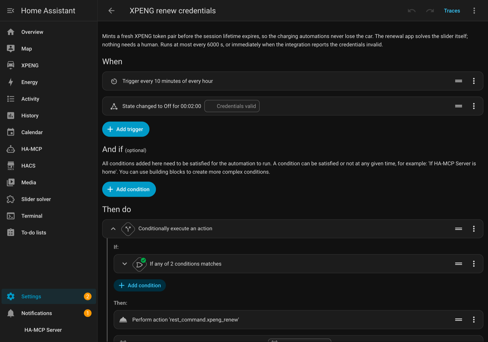
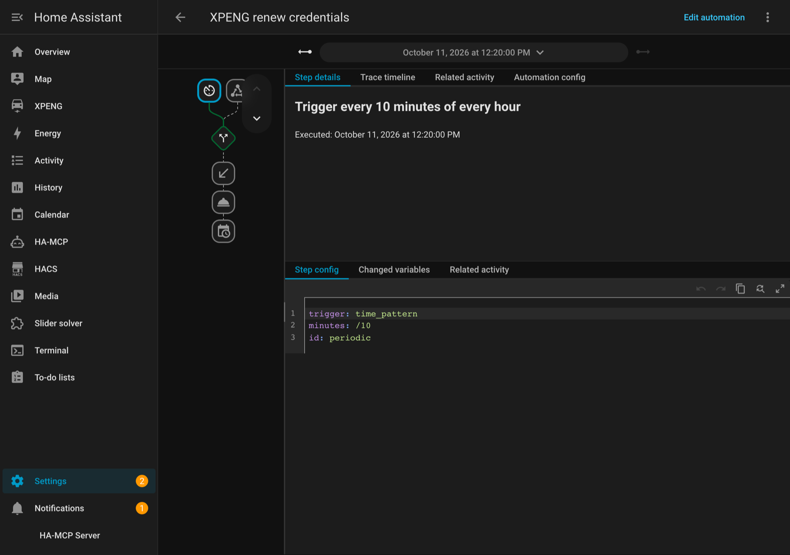

# Automations

## Renew the credentials from Home Assistant (optional)




**The renewal app keeps its own timer**, so this automation is not required to
keep an install alive. What it adds is Home Assistant-side visibility: a helper
that shows when a renewal last ran, and a trigger you can see and edit in the UI.

If you add it, set **`renew_interval: 0`** on the app first, so that the app and
the automation are not both renewing.

`configuration.yaml`:

```yaml
rest_command:
  xpeng_renew:
    url: http://<your-ha-host>:8090/renew
    method: POST
    headers:
      Authorization: !secret xpeng_renew_auth     # "Bearer <renew_token>"
    timeout: 300

input_datetime:
  xpeng_last_renewal:
    name: XPENG last renewal
    has_date: true
    has_time: true
```

Then the automation. Two triggers on purpose: a schedule that stays ahead of the
session cap, and the failure state for the case where it did not.

```yaml
- alias: XPENG renew credentials
  id: xpeng_renew_credentials
  mode: single
  max_exceeded: silent
  triggers:
    # Fires every 10 minutes; the interval condition is what makes it ~100 minutes.
    - trigger: time_pattern
      minutes: "/10"
      id: periodic
    # Or immediately, if the current session is already gone.
    - trigger: state
      entity_id: binary_sensor.xpeng_<vehicle>_credentials_valid
      to: "off"
      for: "00:02:00"
      id: invalid
  conditions: []
  actions:
    # The interval is checked INSIDE the action, not as an automation condition,
    # so that an already-broken session is not made to wait it out.
    - if:
        - condition: or
          conditions:
            - condition: state
              entity_id: binary_sensor.xpeng_<vehicle>_credentials_valid
              state: "off"
              for: "00:02:00"
            - condition: template
              value_template: >-
                {{ states('input_datetime.xpeng_last_renewal')
                   in ['unknown', 'unavailable']
                   or (now().timestamp()
                       - state_attr('input_datetime.xpeng_last_renewal', 'timestamp')) > 6000 }}
      then:
        # Order is the failure policy: a non-2xx answer raises, an action error
        # stops the sequence, and the stamp is skipped — so a failed renewal is
        # retried on the next trigger instead of being suppressed for an interval.
        - action: rest_command.xpeng_renew
        - action: input_datetime.set_datetime
          target:
            entity_id: input_datetime.xpeng_last_renewal
          data:
            timestamp: "{{ now().timestamp() }}"
```

That order is not cosmetic. Verified on a live install: with the app answering
`401` the helper kept its previous value, and with a `200` it was stamped.

A stored trace shows the same run read back — the trigger, and the steps that followed it:



::: warning
`condition: trigger` inside an action's `if` raises without a trigger context, so
a manual **Run** silently does nothing. Gate on the entity's real state, as above
— that works both from the trigger and by hand.
:::

## Act on a notification

XPENG's notifications arrive as a bus event and as a sensor. Either form works.

```yaml
- alias: XPENG notification
  triggers:
    - trigger: event
      event_type: xpeng_notification
  conditions:
    - condition: template
      value_template: "{{ trigger.event.data.category == 'XPMOBILE-VEH' }}"
  actions:
    - action: notify.persistent_notification
      data:
        title: "{{ trigger.event.data.title }}"
        message: "{{ trigger.event.data.message }}"
```

Triggering on the sensor's state is easier to build in the UI, and needs no
template:

```yaml
- alias: XPENG sentry notification
  triggers:
    - trigger: state
      entity_id: sensor.xpeng_<vehicle>_last_notification
  conditions:
    - condition: template
      value_template: "{{ trigger.to_state.attributes.category == 'XPMOBILE-VEH' }}"
  actions:
    - action: notify.mobile_app_your_phone
      data:
        message: "{{ trigger.to_state.state }}"
```

Only **new** notifications fire: the first poll after a restart records the
existing inbox as a baseline, so a restart does not replay the Message Centre into
your automations. See [Notifications](../guide/notifications).

## Tell me when the session dies

`credentials_valid` is the integration's own verdict, and it carries the reason.

```yaml
- alias: XPENG session lost
  triggers:
    - trigger: state
      entity_id: binary_sensor.xpeng_<vehicle>_credentials_valid
      to: "off"
      for: "00:05:00"
  actions:
    - action: notify.persistent_notification
      data:
        title: XPENG credentials invalid
        message: >-
          Reason {{ state_attr('binary_sensor.xpeng_<vehicle>_credentials_valid', 'reason') }},
          {{ state_attr('binary_sensor.xpeng_<vehicle>_credentials_valid', 'consecutive_failures') }}
          consecutive failures. Check the renewal app's run log.
```

Five minutes, not two: the renewal app polls for invalidity every 300 seconds and
may already be fixing it.

## Charge limit before a long drive

The charge limit is a real control on the car, so this works whether or not the
car is plugged in at the time.

```yaml
- alias: XPENG charge limit 100 for the trip
  triggers:
    - trigger: time
      at: "21:00:00"
  conditions:
    - condition: state
      entity_id: calendar.work
      state: "on"
  actions:
    - action: xpeng.set_charge_limit
      data:
        limit: 100
```

## Actions worth knowing

- `xpeng.force_update` asks the car for a fresh frame. It is a **passive** query,
  so it does not wake a sleeping car — which also means it will not produce data
  from one.
- `xpeng.clear_stuck_commands` clears the server-side pending command queue. Use
  it when the car answers `code:12` ("Vehicle controls in used") after a burst of
  commands.
- `xpeng.capture_snapshot` writes every tracked field to
  `<config>/xpeng_snapshots/`, which is useful across an OTA update.

The full list, with every field, is on [Services](../reference/services).
