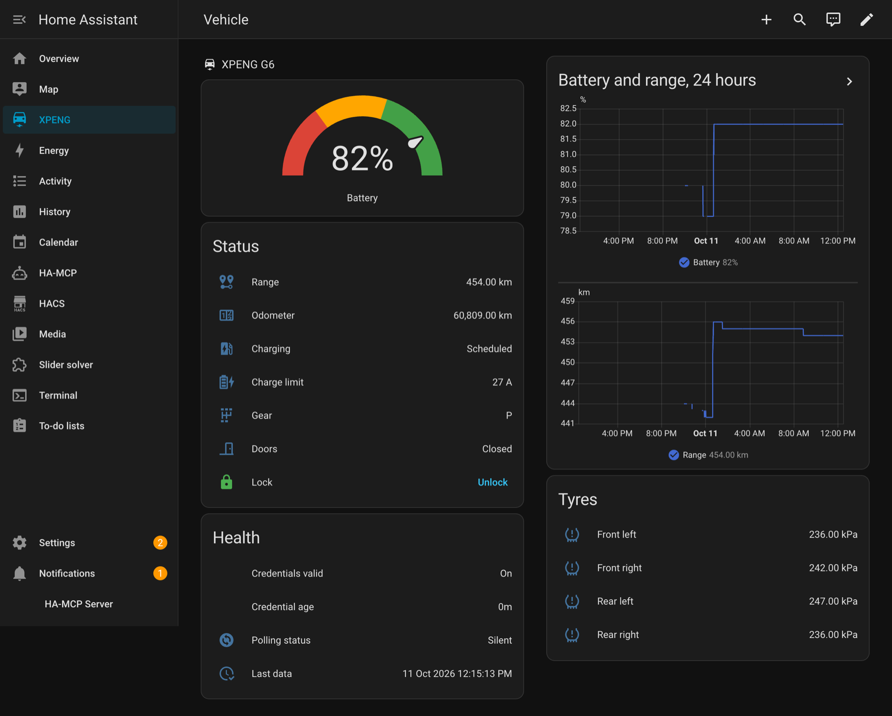

# Dashboard

Everything below uses only built-in cards, so nothing has to be installed from
HACS first. The layout in the screenshot is a **sections** view: each section is a
row, and the cards inside a section share the width.



## The view

Add a dashboard (Settings → Dashboards → Add dashboard), open it, choose
**Edit**, then the three-dot menu → **Raw configuration editor**, and paste this.
Replace `<vehicle>` with your own six-character suffix.

```yaml
title: XPENG
views:
  - title: Vehicle
    path: vehicle
    icon: mdi:car-electric
    type: sections
    max_columns: 4
    sections:
      - type: grid
        cards:
          - type: heading
            heading: XPENG G6
            icon: mdi:car-electric
          - type: gauge
            entity: sensor.xpeng_<vehicle>_battery
            name: Battery
            min: 0
            max: 100
            needle: true
            severity:
              green: 60
              yellow: 30
              red: 0
          - type: entities
            title: Status
            entities:
              - entity: sensor.xpeng_<vehicle>_range
                name: Range
              - entity: sensor.xpeng_<vehicle>_odometer
                name: Odometer
              - entity: sensor.xpeng_<vehicle>_charging_state
                name: Charging
              - entity: sensor.xpeng_<vehicle>_charge_current_limit
                name: Charge limit
              - entity: sensor.xpeng_<vehicle>_shift_state
                name: Gear
              - entity: binary_sensor.xpeng_<vehicle>_doors
                name: Doors
              - entity: lock.xpeng_<vehicle>_door_lock
                name: Lock
          - type: entities
            title: Health
            entities:
              - entity: binary_sensor.xpeng_<vehicle>_credentials_valid
                name: Credentials valid
              - entity: sensor.xpeng_<vehicle>_credential_age
                name: Credential age
              - entity: sensor.xpeng_<vehicle>_polling_status
                name: Polling status
              - entity: sensor.xpeng_<vehicle>_last_data_update
                name: Last data
      - type: grid
        cards:
          - type: history-graph
            title: Battery and range, 24 hours
            hours_to_show: 24
            entities:
              - entity: sensor.xpeng_<vehicle>_battery
                name: Battery
              - entity: sensor.xpeng_<vehicle>_range
                name: Range
          - type: entities
            title: Tyres
            entities:
              - entity: sensor.xpeng_<vehicle>_tyre_pressure_front_left
                name: Front left
              - entity: sensor.xpeng_<vehicle>_tyre_pressure_front_right
                name: Front right
              - entity: sensor.xpeng_<vehicle>_tyre_pressure_rear_left
                name: Rear left
              - entity: sensor.xpeng_<vehicle>_tyre_pressure_rear_right
                name: Rear right
```

::: details Why the Health card is worth keeping
`credentials_valid` is the integration's own verdict on the current session, and
`credential_age` resets when a credential is minted (a reconnect or a renewal), so it
can be large on a healthy long-lived session; pair it with `credentials_valid`.
If the first goes `off` and stays there, or the second climbs past a few minutes,
the car is about to stop reporting and a renewal is needed — see
[Fault finding](../guide/fault-finding).
:::

## A compact alternative

If you would rather have one card than a dashboard, a single entities card covers
the same ground:

```yaml
type: entities
title: XPENG
entities:
  - sensor.xpeng_<vehicle>_battery
  - sensor.xpeng_<vehicle>_range
  - sensor.xpeng_<vehicle>_charging_state
  - sensor.xpeng_<vehicle>_charge_current_limit
  - binary_sensor.xpeng_<vehicle>_doors
  - lock.xpeng_<vehicle>_door_lock
```

## Controls

The writable entities — `lock`, `climate`, the charge-limit number and the
switches — can be dropped straight onto a dashboard, but they are **optimistic**:
the card shows what was asked for until the car confirms it. A command that
reports success is not proof the car acted, so read the state back rather than
trusting the card for a few seconds. See
[Entities](../reference/entities#remote-commands).
