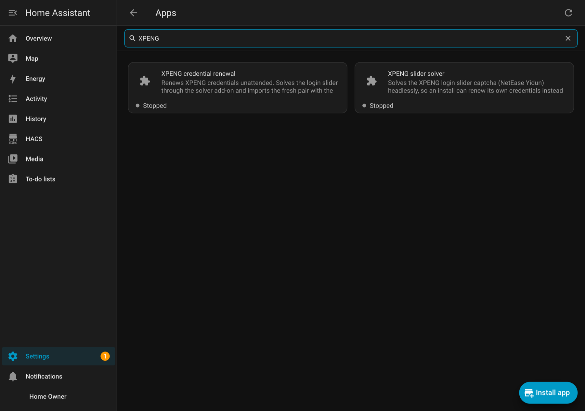
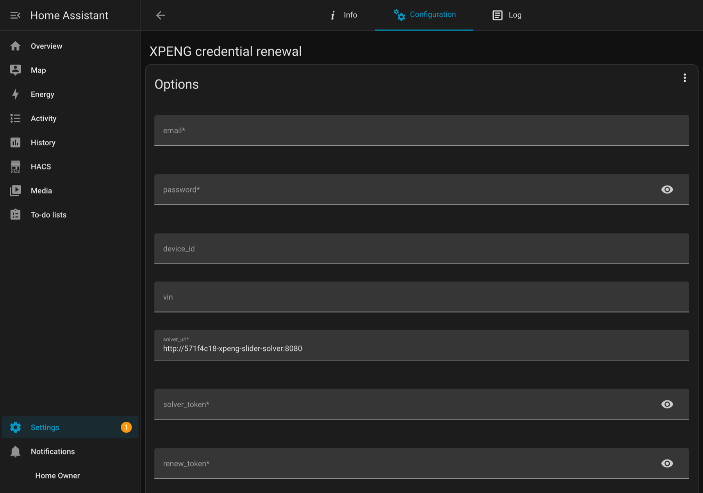

# Unattended renewal

XPENG retires a session about two hours after the login that created it, and a
refresh cannot extend it — measured at 2 h 12 m, 2 h 03 m and about 2 h on two
accounts, with the refresh loop healthy right up to the moment the server ended
it. One install has since run for **days** without an expiry, so treat the two
hours as the common case rather than a rule - see
[the device identity](./device-identity). An install meant to run for weeks
therefore has to log in again before that happens, and a login normally needs a
human to drag a slider.

Two apps remove the human, and the renewal app decides when:

```text
automation (schedule)  ->  rest_command  ->  XPENG credential renewal (worker)
                                              |  POST /solve   -> slider solver
                                              |  pwdLogin + guardian -> new pair
                                              `  xpeng.import_credentials (service)
```

Where you use an automation it is the clock and the policy. The worker holds the
account password and does the privileged part. The integration validates the
result before anything is swapped, exactly as the Repairs card does.

::: info
Home Assistant renamed add-ons to **apps** in 2026.2. The store, the options and
everything below are the same thing under the new name.
:::

## Why the slider is the only human step

XPENG gates sign-in with its own slider captcha (NetEase Yidun). The server
answers the email/password step with `12040101` (slider demanded) and `12040106`
(`Slider captcha validation failed`) until a human drags it. That drag needs a
real browser window, so it cannot be solved from inside Home Assistant — the
config flow has no way to render or complete it. Everything else about the login
is plain HTTP, which is why a solver is enough to make renewal unattended.

## Install the two apps

Both are ordinary apps, and both are needed:

* **[XPENG slider solver](https://github.com/xpengtoolkit/slider-solver)** — solves
  the login captcha, which is the one human step in onboarding.
* **XPENG credential renewal** — this repository. It mints a fresh pair ahead of
  the two-hour cap and imports it with `xpeng.import_credentials`, the same
  service the Repairs card uses.

**Settings → Apps → Install app → three-dot menu → Repositories**, add this
repository's URL and the solver's, then install both. (Home Assistant renamed
add-ons to **apps** in 2026.2; older releases call the same screen the Add-on
Store.)



The solver is self-hosted and separate. It clears the account owner's own
challenge on a host they control, so keep it private and never expose it without
`SOLVER_TOKEN`.

## The app's options



| Option | Meaning |
| --- | --- |
| `email` / `password` | The account this install renews. Use the second, dedicated account, never the one signed into the phone app: XPENG keeps one session per account, so the app logging in evicts this one. |
| `renew_token` | The secret the automation presents to `POST /renew`. **Set it** — the worker holds your password. |
| `solver_url` | Where the solver app listens. Defaults to `http://571f4c18-xpeng-slider-solver:8080`, the solver's container hostname as installed from the store. See [below](#if-solver_url-does-not-resolve). |
| `solver_token` | The solver's `solver_token`, if you set one. |
| `device_id` | Optional, and worth pinning. Leave it blank and the first renewal's device id is remembered in `/data/device_id.txt` and reused, so the identity at least does not change every two hours. Do not change it on a live install — see [the device identity](#the-device-identity). |
| `pair_dir` | Where the fresh pair is written for Home Assistant to read: `/config/xpeng-secrets` by default. |
| `vin` | Only needed if the token file carries no VIN. The onboarding tool records one, so normally leave this blank. |
| `renew_interval` | The app's own renewal timer, in seconds: 6000 by default. Set it to `0` to disable the scheduler and leave triggering to Home Assistant or to you. |
| `invalid_poll_interval` | How often to ask Home Assistant whether the credentials are still valid (300 s), so a session that dies early is replaced within a few minutes. |

Give `pair_dir` a second thought: it is live credentials on disk, readable by the
Core process. `chmod 700` the directory, and do not put it in a share.

### If solver_url does not resolve {#if-solver_url-does-not-resolve}

This is the one setting that depends on how the solver was installed, and getting
it wrong looks like "the slider never gets solved":

| How the solver was installed | `solver_url` |
| --- | --- |
| from the store, `xpengtoolkit/slider-solver` | `http://571f4c18-xpeng-slider-solver:8080` (the default) |
| as a local app folder named `slider_solver` | `http://local-xpeng-slider-solver:8080` |
| anything else | `http://<your-ha-host>:8080` |

**It is the hostname that resolves, not the slug** — hyphens, not underscores. The
slug forms (`571f4c18_xpeng_slider_solver`, `local_xpeng_slider_solver`) fail with
`No address associated with hostname`. The plain host address always works, so it
is the safe answer when in doubt. Changing this option restarts the app.

## First run creates the config entry

A renewal *imports* the pair it minted, and importing needs somewhere to import it
to. On a brand-new install there is no XPENG entry yet — so the app creates one,
by driving the config flow with the pair it just minted. The first run finishes the
install; nothing is pasted and nothing is typed.

**It cannot be done through `xpeng.import_credentials`**, which is the obvious fix
and does not work. Measured on an install with no config entry: the `xpeng` service
domain is absent from `/api/services`, because the integration's component-level
setup runs only once an entry exists, so there is no `import_credentials` to call —
and starting a config flow does not load it either. The config flow *is* loaded on
demand, and creating the entry through it is what loads the component and registers
the service for every renewal after the first one.

### The VIN

The flow requires a VIN, and it decides the entity ids. The onboarding tool records
it in the token file — read from the vehicle list straight after the login — so
normally there is nothing to think about. For a pair written before that, or by
hand, set the app's **`vin`** option, or add the integration once by hand and
import the pair with **Import tokens**.

### When it does not work

| Message | What it means |
| --- | --- |
| `no VIN to create the config entry with` | As above: set `vin`, or add the integration by hand once. |
| `could not start the config flow` / `the entry was not created` | The response names the step that refused. The usual cause is `pair_dir` not being under `/config`: the flow reads those paths **inside the Home Assistant container**, which cannot see the app's own filesystem. |
| `import_credentials returned 400: No XPENG config entry to import credentials into` | The app only calls that service when an entry already exists, so this means the entry disappeared between the check and the call. Run it again. |

The whole attempt is written to `/config/xpeng-renew-last-run.log`.

The app needs permission to call that service; it asks for `homeassistant_api` in
its own config, which is what makes the import and its failure notifications
possible. A `401 Unauthorized` from the import step rather than a 400 means that
grant is missing.

## Home Assistant side (optional)

**The app renews on its own timer, so none of this is required.**
`renew_interval` (6000 s by default) decides when, and every
`invalid_poll_interval` (300 s) the app asks the integration whether the credentials
have already gone — so a session that dies early is replaced within a few minutes.

What an automation adds is Home Assistant-side visibility: a helper that shows when
a renewal last ran, on a dashboard, and a trigger you can see and edit in the UI. If
you want that, set **`renew_interval: 0`** on the app first, so the two are not both
renewing.

> **Two things trip people up here.** The sensor is
> `binary_sensor.xpeng_<the last six characters of your VIN>_credentials_valid` - for the
> VIN `L1NNSGHA3SB800783` that is `binary_sensor.xpeng_800783_credentials_valid`. Find
> yours under **Settings -> Devices & Services -> Entities**, searching for
> `credentials_valid`, and use exactly what you find; the placeholder is not a name
> anything ships with. The `input_datetime` block below is also not decoration: the
> automation reads it as its clock. If `input_datetime.xpeng_last_renewal` is not in your
> entities, either the block never reached `configuration.yaml` or Home Assistant has not
> been restarted since - and the automation will do nothing until it is. See *Avoiding the
> helper* below if you would rather not create it at all.

`configuration.yaml`:

```yaml
rest_command:
  xpeng_renew:
    url: http://<your-ha-host>:8090/renew
    method: POST
    headers:
      Authorization: !secret xpeng_renew_auth     # "Bearer <renew_token>"
    timeout: 300

input_datetime:
  xpeng_last_renewal:
    name: XPENG last renewal
    has_date: true
    has_time: true
```

Then the automation. Two triggers on purpose: a schedule that stays ahead of the
cap, and the failure state for the case where it did not.

```yaml
- alias: XPENG renew credentials
  id: xpeng_renew_credentials
  mode: single
  max_exceeded: silent
  triggers:
    # Fires every 10 minutes; the interval condition is what makes it ~100 minutes.
    - trigger: time_pattern
      minutes: "/10"
      id: periodic
    # Or immediately, if the current session is already gone.
    - trigger: state
      entity_id: binary_sensor.xpeng_<vehicle>_credentials_valid
      to: "off"
      for: "00:02:00"
      id: invalid
  conditions: []
  actions:
    # The interval is checked INSIDE the action, not as an automation condition,
    # so that the already-broken case is not made to wait it out: while the
    # credentials are invalid the car is unreachable, and gating that path would
    # leave it that way for up to a whole interval.
    - if:
        - condition: or
          conditions:
            - condition: state
              entity_id: binary_sensor.xpeng_<vehicle>_credentials_valid
              state: "off"
              for: "00:02:00"
            - condition: template
              value_template: >-
                {{ states('input_datetime.xpeng_last_renewal')
                   in ['unknown', 'unavailable']
                   or (now().timestamp()
                       - state_attr('input_datetime.xpeng_last_renewal', 'timestamp')) > 6000 }}
      then:
        # Order is the failure policy. A non-2xx answer (the worker returns 502
        # for a failed renewal, 401 for a bad token) raises, an action error
        # stops the sequence, and the stamp below is therefore skipped — so a
        # failed renewal is retried on the next trigger instead of being
        # suppressed for a whole interval.
        - action: rest_command.xpeng_renew
        - action: input_datetime.set_datetime
          target:
            entity_id: input_datetime.xpeng_last_renewal
          data:
            timestamp: "{{ now().timestamp() }}"
```

That order is not cosmetic. Verified on a live install: with the worker answering
`401` the helper kept its previous value, and with a `200` it was stamped.

### Avoiding the helper

The helper exists to give the automation a clock and to put that clock on a dashboard. If
you would rather not declare anything in `configuration.yaml`, an automation can use its
own `last_triggered` instead - replace the `template` condition with:

```yaml
            - condition: template
              value_template: >-
                {{ this.attributes.last_triggered is none
                   or (now() - this.attributes.last_triggered).total_seconds() > 6000 }}
```

and delete the final `input_datetime.set_datetime` action. `last_triggered` is `none` on
the first run, which is what the first line covers, so the first renewal happens as soon
as the automation is enabled. The trade is visibility: the helper is an entity you can put
on a dashboard, while `last_triggered` is only visible in the automation's attributes.

### Why a helper, and 6000 seconds

`credentials_valid` carries `age_s`, but that is the time since the last *mint*
(about 45 seconds while healthy), not the age of the session — useless for this.
What matters is when the last **login** happened, and a renewal *is* a login, so
"last successful renewal" is exactly the right clock. Stamping `input_datetime` on
success is what makes that visible in Home Assistant; the app's own answer is
`/healthz`'s `next_run_s` and `last_reason`, which no dashboard can show.

6000 seconds is 100 minutes: 20 minutes inside the measured ~2 hours, which leaves
room for a retry if something fails. The automation re-fires every 10 minutes while
the condition holds, so a failure retries on its own.

## The device identity

The app logs in as a *device*, and which device id that is matters more than the
schedule. Measured on one install:

* with a freshly minted random device id, `credentials_valid` went invalid every
  ~2 h 07 m–2 h 27 m — the cap;
* after re-onboarding the same account with the device id already used by the
  phone, the session stayed valid for **3 h 44 m and counting**, with no `12010202`
  ("Login status has expired") anywhere in the log.

So a session bound to an identity XPENG has seen before outlives one bound to a
brand-new identity. Practical consequences:

* The 100-minute cycle is correct either way, and it is what makes a fresh install
  work: a new install mints a new id and gets about two hours.
* If you want the longer sessions, set `device_id` explicitly to an id that install
  has used before (32 lowercase hex characters) and leave it set.
* Whatever you do, do not let it change on every renewal — that is what the app's
  remembered id in `/data/device_id.txt` prevents. Changing it on a live install is
  the trap in [Fault finding](./fault-finding#most-entities-are-unknown).

## Testing without waiting two hours

Open the interval on purpose rather than shortening the code: set
`input_datetime.xpeng_last_renewal` to a time more than 6000 seconds ago
(**Developer Tools → Actions → `input_datetime.set_datetime`**), then run the
automation from **Settings → Automations**. A successful cycle stamps the helper
back to now; a failed one leaves it alone, which is the behaviour you want to
confirm.

Because the interval is checked inside the action, **Run** in the UI works for
this. An earlier revision gated on the trigger id instead, which silently did
nothing when run by hand.

To force a renewal with no automation at all:

```bash
curl -X POST -H "Authorization: Bearer <renew_token>" http://<your-ha-host>:8090/renew
```

## Where to look when it fails

Read these in order:

1. **`/config/xpeng-renew-last-run.log`** — the complete output of the last
   renewal, rewritten on every run. It contains the tool's own progress lines and
   whatever the browser or the API said, so it is usually the whole answer. Treat it
   as sensitive: it describes the account's login attempts.
2. **`GET http://<your-ha-host>:8090/healthz`** — renewals, failures, consecutive
   failures, when the next renewal is due, and the last outcome including what
   `xpeng.import_credentials` returned.
3. **The Home Assistant log** — `homeassistant.components.rest_command` errors name
   the status the renewal app answered with.
4. **Most entities `unknown` while the credentials are healthy** — that is the
   competing-MQTT-client case, not a credential problem. See
   [Fault finding](./fault-finding#most-entities-are-unknown).

The worker raises a persistent notification after **two consecutive failures**.
Home Assistant 2026.10 no longer exposes persistent notifications as
`persistent_notification.*` entities, so look in the notifications panel in the UI
rather than in the state list.
