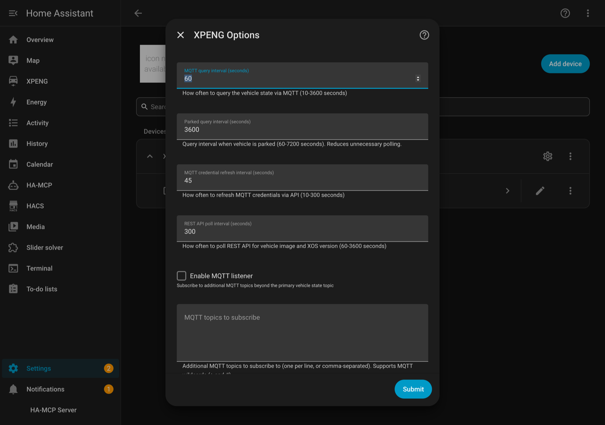

# Configuration

**Configure → XPENG Options** is a single form, and a typical install needs
nothing changed on it. Every option has a working default; the polling intervals,
the MQTT listener and the certificate directory are only worth revisiting for a
specific reason, and the two legacy file options are for installs that keep the
credential pair on disk instead of on the config entry.



Reached from _Settings → Devices & services → XPENG → **Configure**_. Saving the
form reloads the config entry, so the new intervals and the reconnected MQTT
client take effect immediately. Saving also re-validates the certificate
directory (see [Certificate directory](#certificate-directory)).

## Summary

| Option | Label in the form | Default | Accepted |
| --- | --- | --- | --- |
| `scan_interval` | MQTT query interval (seconds) | `60` | `10`–`3600` |
| `parked_scan_interval` | Parked query interval (seconds) | `3600` | `60`–`7200` |
| `mqtt_refresh_interval` | MQTT credential refresh interval (seconds) | `45` | `10`–`300` |
| `rest_scan_interval` | REST API poll interval (seconds) | `300` | `60`–`3600` |
| `mqtt_listener_enabled` | Enable MQTT listener | off | on / off |
| `mqtt_listener_topics` | MQTT topics to subscribe | empty | free text, one topic per line or comma-separated |
| `mqtt_topic_discovery` | Enable MQTT topic discovery | off | on / off |
| `token_file` | Login token file (legacy) | empty | absolute path |
| `tenant_file` | Tenant cache file (legacy) | `/config/custom_components/xpeng/xpeng_tenant.json` | absolute path |
| `cert_dir` | Certificate directory | `/config/custom_components/xpeng/certs` | absolute path holding three PEM files |
| `command_mode` | Command permissions | `safe_plus` on a new entry; Full access when unset | `read_only` / `safe` / `safe_plus` / `full` / `custom` |
| `allow_wake` | Allow the integration to wake the car | on | on / off |
| `iccid` | TBox SIM ICCID | empty | free text, diagnostic only |
| `usable_battery_kwh` | Usable battery capacity (kWh) | `87.5` | `10`–`150` |

Ranges are the `vol.Range(...)` bounds enforced in `config_flow.py`, and the help
text quotes the same numbers. Where the code and the translations disagree, that
is noted in the option's own section below.

## Polling intervals

Three independent schedules run at once: the periodic MQTT query, the cloud-side
credential refresh, and the REST poll. The integration publishes what each is
doing now — see `sensor.xpeng_<vehicle>_polling_status` and
`sensor.xpeng_<vehicle>_next_poll` on [Entities](./entities).

### `scan_interval`

How often the vehicle state is queried over MQTT while the car is **active** —
charging, or driving. Default **60 s**, accepted **10–3600 s**.

While active the query is a `cmd_type: 2` **force-upload**, not a passive query:
the car is already awake, so this wakes nothing, and it is the only reliable way
to get a fresh full state because XPENG's autonomous push stream and cloud fanout
stall without warning. The timer ticks on this interval in every state, so it is
also the granularity at which a parked query can be sent (below).

### `parked_scan_interval`

How often the car is queried while it is **parked and idle**. Default **3600 s**
(one hour), accepted **60–7200 s**.

A parked car is **never force-woken**. The integration sends one *passive* state
query per parked interval and lets the car sleep; a sleeping car answers that
query with a stub, which is enough to keep the entities from looking stale and is
not a fault. The interval is therefore a trade-off between how promptly a parked
car's values refresh and how much the car is disturbed — and this option also
slows the **REST** poll, which uses `rest_scan_interval` while active and this
value while parked. Raising it to `7200` halves both.

::: info Parked/Silent flapping is normal
The quiet interval and the silence threshold are deliberately different units of
scale. `parked_scan_interval` is measured in hours; the silence threshold is
**300 s**, and the watchdog that reads it runs every 60 s. A parked car that
answered its hourly query at 09:00 therefore looks `Silent` from about 09:05
until the next query, at which point the status sensor returns to `Parked`. Both
readings are correct: `Parked` is the cadence, `Silent` is "the state topic has
been quiet past the threshold".

The reconnect that `Silent` triggers is cloud-side only and never wakes the car.
Waking it is a separate escalation that needs **30 minutes of unbroken silence**
first, and is capped at one force-upload per **12 hours** — so a car parked and
asleep all day is woken at most twice, and one that answers the passive query is
never woken by this path at all.
:::

### `mqtt_refresh_interval`

How often fresh MQTT credentials (clientId and password) are minted through the
cloud API. Default **45 s**, accepted **10–300 s**.

The broker's credentials are short-lived, so the integration rotates them ahead
of the expiry rather than reconnecting with a superseded password. The refresh
loop only runs when the integration has app-tier credentials; a token file
without them leaves it disabled. There is no reason to lower this, and raising it
towards `300` trades a little API traffic for a larger chance that a reconnect
lands on a retired password.

### `rest_scan_interval`

How often the REST API is polled for the data MQTT does not carry — the vehicle
image, the XOS version, the energy report and the rest of the supplementary
widgets. Default **300 s**, accepted **60–3600 s**.

The REST poll follows the car's state: this interval while active/driving,
`parked_scan_interval` while parked. Push notifications are on their own fixed
300 s timer and are not affected by this option.

## MQTT listener

The primary vehicle-state topic is always subscribed. These three options add
*extra* subscriptions for diagnostics and reverse-engineering; none of them
affects the entities built from the primary topic.

### `mqtt_listener_enabled`

Subscribes the additional topics. Default **off**. With it off,
`mqtt_listener_topics` and `mqtt_topic_discovery` are stored but not used — the
listener is not configured and nothing extra is subscribed.

### `mqtt_listener_topics`

The extra topics to subscribe, one per line or comma-separated. Default empty.
MQTT wildcards (`+` and `#`) are supported, and each topic is trimmed; topics
longer than 512 characters are dropped. Subscriptions are attempted at connect
time and the result of each one is recorded, so a topic the broker refuses is
visible rather than silently missing.

### `mqtt_topic_discovery`

Tries a fixed list of known XPENG broker topics in addition to the ones typed
above — the CAN packs (`Xmart/Car/+/State/CanPack1s`, `Xmart/Tbox/+/CanPack1s`,
`Xmart/TboxD21B/+/CanPack1s`, the `$local/$queue/…` variants), T-box status
(`Xmart/Tbox/+/StatPack`), client connect events, CDU log statistics and
`Xmart/Car/+/CanPackV2/Repub`. Default **off**.

This is for finding out what the broker will hand out on your account; the payloads
are not parsed into entities. What actually arrived is reported by
`sensor.xpeng_<vehicle>_mqtt_listener` (a count, the last topic and payload, and a
rolling log), each message is also fired on the bus as `xpeng_mqtt_message`, and
the accepted/refused result of every subscription is reported by
`sensor.xpeng_<vehicle>_mqtt_discovery`. Note that the listener sensor reads
`No messages` on a healthy install, because vehicle data arrives over the REST
poll (see [Entities](./entities)).

## Legacy credential files

An in-Home-Assistant login — **Import tokens from the onboarding tool**, Google or
email — stores the token and tenant pair on the config entry itself, and that pair
always wins. The two file options are the fallback for installs that keep a pair
on disk from the command-line tooling. Both are ignored unless the token file
actually exists.

### `token_file`

Path to a `xpeng_tokens.json` written by the CLI login tooling. Default **empty**
(the option is not pre-filled). When set and present, the integration loads the
pair from `token_file` plus `tenant_file` for its app-tier API calls, and the
entry's own stored pair takes precedence when it has one.

::: info
`const.py` also defines `DEFAULT_TOKEN_FILE`
(`/config/custom_components/xpeng/xpeng_tokens.json`), but the options form
defaults this field to empty and does not use that constant. `tenant_file` does
default to its `DEFAULT_TENANT_FILE`.
:::

### `tenant_file`

Path to a cached `xpeng_tenant.json`. Default
`/config/custom_components/xpeng/xpeng_tenant.json`, as the help text says. If the
file is missing or unreadable it is fetched and written here, so a file-based
install heals itself on the next API call.

The tenant carries the `deviceId` the token pair was sealed against. A tenant
from a different onboarding run than the tokens is rejected, and an install whose
entry is configured with one device id while the tenant records another fails
every API call with `12010104 "Login status expired"` until it is re-onboarded.

## Certificate directory

### `cert_dir`

Absolute path to the directory holding the mTLS material for the XPENG broker.
Default `/config/custom_components/xpeng/certs`, which is the directory the
integration ships in. Resolution order:

1. this option, when it is set to a non-empty path;
2. otherwise the default, `/config/custom_components/xpeng/certs` — the same
   directory as the integration's bundled `certs/`, which is why the default
   works on a fresh install.

The path is used exactly as typed: there is no `~` expansion, and an absolute
path is expected. The directory must contain all three files —

| File | Purpose |
| --- | --- |
| `ca-chain.crt` | XPENG CA chain; the broker's certificate is verified against it, with hostname checking on |
| `client-cert-0.pem` | the client certificate |
| `client-key.pem` | the matching private key |

— and **saving the form with a non-empty value validates them**. If any is
missing the form is re-rendered with the error *"One or more certificate files
are missing from that directory. It must contain ca-chain.crt,
client-cert-0.pem and client-key.pem."* and nothing is saved. A blank value is
accepted and means "use the default directory". The same directory is published
to the REST client, so the two channels use one copy of the material, and a
missing file at setup time is reported as a setup failure rather than a silent
connection error.

::: warning
`ca-chain.crt` is a public trust anchor, but `client-cert-0.pem` and
`client-key.pem` are not: they are credentials. Keep them inside `/config`, out
of any share, and do not paste them into a dashboard or a log.
:::

## Vehicle identity and capacity

### `iccid`

The TBox SIM's ICCID, if you want it in Home Assistant. Default empty. It is
purely diagnostic: no integration behaviour reads it.

There is **no app-tier API that exposes the ICCID**, so nothing can discover it
for you. Read it on the car's head unit with:

```text
*#9925*131#
```

Enter the digits here and the integration creates
`sensor.xpeng_<vehicle>_tbox_iccid` for it; with the option empty that entity
does not exist at all. The value is stored in the config entry and in the
recorder database, so treat it as you would any other vehicle identifier.

### `usable_battery_kwh`

The usable pack size used to turn an observed state-of-charge drop into an energy
estimate while the car is parked and idle. Default **87.5** kWh, accepted
**10–150**. Each detected 1% drop contributes `usable_battery_kwh / 100` to the
parked-consumption sensors.

The car reports a percentage, not kilowatt-hours, so this number is what makes
`sensor.xpeng_<vehicle>_parked_consumption` meaningful for your trim:

| Model | Approximate usable capacity |
| --- | --- |
| G6 Long Range | `87.5` |
| G6 Standard Range | `66` |

A value that is too high overstates parked drain and a value that is too low
understates it; nothing else in the integration depends on the figure, and the
estimate is also bounded per hour and per step in the coordinator so that a
mis-set value cannot produce an absurd reading.

## Command permissions

The first two fields on the form decide what the integration may do to the car at all.
`command_mode` is a preset - **Read only**, **Safe**, **Safe Plus** or **Full access**
- and choosing **Custom** opens a second screen with one dropdown per capability group.
`allow_wake` is separate because waking a sleeping car costs a little of its 12V
battery: with it off the integration sends queries only, and the watchdog degrades to a
passive query instead of a force-upload.

| Setting | A new entry starts at | An entry with no stored value |
| --- | --- | --- |
| `command_mode` | `safe_plus` | **Full access** |
| `allow_wake` | on | on |

The second column is the upgrade guarantee: an install that predates the option keeps
Full access, so an update never takes charging or unlocking away from an automation
that relies on it. See [Command permissions](./command-permissions) for the groups,
what each one covers, and what the mode does *not* protect against.

## Fixed timers

These are constants, not options — listed so the numbers in the sections above
have a source.

| Behaviour | Value |
| --- | --- |
| Silence threshold before the status reads `Silent` | `300 s` |
| Watchdog tick | `60 s` |
| Minimum gap between watchdog reconnects | `600 s` |
| Unbroken silence before an escalating force-upload | `1800 s` (30 min) |
| Minimum gap between escalating force-uploads | `43200 s` (12 h) |
| Push-notification poll | `300 s` |

See also [Services](./services) for the commands that act on the car, and
[App options](./app-options) for the two companion apps.
